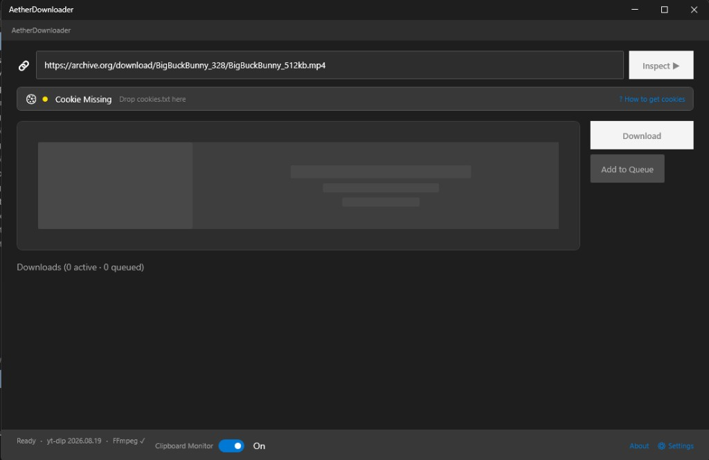
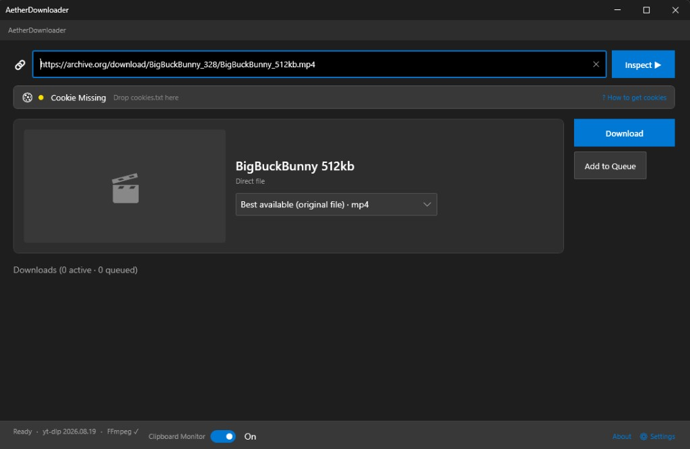
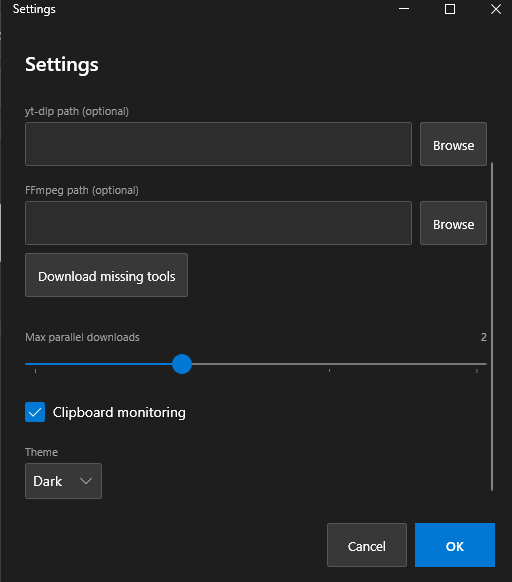
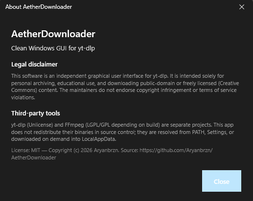

# AetherDownloader — Windows GUI for yt-dlp

**AetherDownloader** is a free, open-source **Windows desktop GUI for [yt-dlp](https://github.com/yt-dlp/yt-dlp)** with optional **[FFmpeg](https://ffmpeg.org/)** support. Paste a media URL, inspect available formats, pick a quality, and download to a folder on your PC — without using the command line.

> Built for **personal archiving**, **education**, and **public-domain / Creative Commons** media.  
> Not affiliated with yt-dlp or FFmpeg. Not a service for bypassing paywalls or DRM.

**Repository:** [github.com/Aryanbrzn/AetherDownloader](https://github.com/Aryanbrzn/AetherDownloader)  
**License:** [MIT](LICENSE) · **Platform:** Windows 10 / 11 · **Stack:** .NET (WPF)

---

## What you can do

| Feature | Description |
|--------|-------------|
| Inspect URLs | Fetch title, duration, thumbnail, and format list via yt-dlp |
| Choose quality | Select resolution or audio-oriented formats before download |
| Queue downloads | Run jobs with progress in a simple download queue |
| Cookie profiles | Import a `cookies.txt` you are allowed to use (optional) |
| Clipboard monitor | Optionally detect pasted URLs |
| Tool setup | Detect yt-dlp / FFmpeg on PATH, or download official builds into LocalAppData |
| Proxy | Works with `HTTP_PROXY` / `HTTPS_PROXY` environment variables (used by yt-dlp) |

---

## Screenshots

### Main window

Paste a URL and inspect it before downloading.



### Inspect & formats

Review metadata and pick a format (example: public Big Buck Bunny sample on Internet Archive).



### Settings & tools

Output folder, optional tool paths, and **Download missing tools** for official yt-dlp / FFmpeg builds.



### About & disclaimer

In-app legal notice for permitted use.



---

## Intended use (please read)

AetherDownloader is a **local GUI wrapper**. You are responsible for what you download and for following:

- copyright law in your country  
- the terms of any site you access  
- the licenses of yt-dlp and FFmpeg  

**Allowed examples:** public-domain films, Creative Commons uploads, your own content, material you have a clear right to archive.

**Not endorsed:** downloading copyrighted commercial media without permission, evading technical protection measures, or violating a site’s terms of service.

### Legal disclaimer

This software is an independent graphical user interface for yt-dlp. It is intended solely for personal archiving, educational use, and downloading public-domain or freely licensed (Creative Commons) content. The maintainers do not endorse copyright infringement or terms of service violations.

The same text appears in the app under **About**.

---

## Download (end users)

1. Open **[Releases](https://github.com/Aryanbrzn/AetherDownloader/releases)** and get the latest Windows build (zip).
2. Extract the archive and run `AetherDownloader.App.exe`.
3. If yt-dlp or FFmpeg is missing, confirm the in-app download prompt, or open **Settings → Download missing tools**.
4. Try a freely licensed sample, for example:  
   [Big Buck Bunny (Internet Archive)](https://archive.org/download/BigBuckBunny_328/BigBuckBunny_512kb.mp4) → **Inspect** → **Download**.

> If no Release is published yet, build from source (next section).

### Requirements (running a release)

- Windows 10 or 11  
- [.NET 10 Desktop Runtime](https://dotnet.microsoft.com/download) (if the build is framework-dependent)  
- [Visual C++ Redistributable](https://learn.microsoft.com/en-us/cpp/windows/latest-supported-vc-redist) (usually already installed)  
- **yt-dlp** and **FFmpeg** — not stored in this Git repository; installed by you or by the app into `%LOCALAPPDATA%\AetherDownloader\tools`

---

## Build from source (developers)

```powershell
git clone https://github.com/Aryanbrzn/AetherDownloader.git
cd AetherDownloader
dotnet restore
dotnet build AetherDownloader.sln -c Release
dotnet run --project src/AetherDownloader.App/AetherDownloader.App.csproj -c Release
```

```powershell
dotnet test AetherDownloader.sln
```

Publish a folder you can zip for Releases (do **not** commit `publish/`):

```powershell
dotnet publish src/AetherDownloader.App/AetherDownloader.App.csproj -c Release -o ./publish
```

Optional local yt-dlp for tests: see [`tools/yt-dlp/README.md`](tools/yt-dlp/README.md) (binaries are gitignored).

---

## How tools are resolved

1. Paths set in **Settings** (if valid)  
2. Managed install under `%LOCALAPPDATA%\AetherDownloader\tools`  
3. Optional developer copy under `tools/yt-dlp/` next to the app  
4. System `PATH`

Source control does **not** ship `yt-dlp.exe` or `ffmpeg.exe`.

---

## Privacy & security notes

- Settings and logs live under `%APPDATA%\AetherDownloader\`  
- Cookie files you import are stored locally; treat them as secrets — never commit them  
- Report vulnerabilities privately: see [SECURITY.md](SECURITY.md)  
- Contributions: see [CONTRIBUTING.md](CONTRIBUTING.md)

---

## Third-party software

| Project | Role | License (upstream) |
|--------|------|--------------------|
| [yt-dlp](https://github.com/yt-dlp/yt-dlp) | Download engine | Unlicense |
| [FFmpeg](https://ffmpeg.org/) | Mux / convert when needed | LGPL or GPL (depends on the build you install) |

AetherDownloader is only a GUI. Upstream projects keep their own licenses and trademarks.

---

## Keywords

`yt-dlp gui` · `yt-dlp windows` · `ffmpeg windows gui` · `open source media downloader` · `wpf yt-dlp` · `creative commons downloader` · `public domain video download`

---

## License

[MIT License](LICENSE) — Copyright © 2026 [Aryanbrzn](https://github.com/Aryanbrzn).

yt-dlp and FFmpeg are **not** redistributed in this repository; obtain them separately or via the in-app bootstrapper and comply with their licenses.
